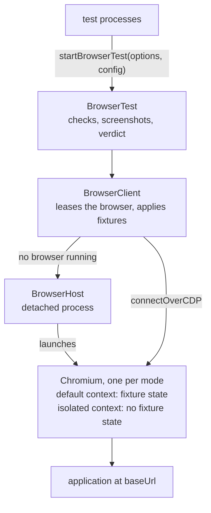

# @blockchainian/browser-test

A Playwright harness that runs each browser test as its own Node process. Tests in each mode share one Chromium that the project's fixtures prepare once.

## Install

```sh
yarn add -D github:blockchainian/browser-test#<sha> playwright@1.64.1
```

## Architecture



| Component       | Responsibility                                                                                                  |
| --------------- | --------------------------------------------------------------------------------------------------------------- |
| `BrowserTest`   | Owns the test's page, records checks, screenshots and console errors, and prints the verdict.                   |
| `BrowserClient` | Leases the browser, starts the host when none runs, applies fixtures and closes Chromium once no test needs it. |
| `BrowserHost`   | Keeps Chromium running after the test that started it, with a persistent profile and the config's `launchArgs`. |

## Config and fixtures

```ts
type Fixture = { name: string, isReady(context: BrowserContext): Promise<boolean>, apply(context: BrowserContext): Promise<void> }
type BrowserTestConfig = { baseUrl: string, fixtures?: Fixture[], launchArgs?: string[] } // launchArgs extend Chromium's flags
```

A fixture prepares the shared default context. A test names the fixtures it needs in `requires. A new browser first records every fixture the profile already satisfies.

A test whose `requires` covers every recorded fixture runs in the shared default context and shares its cookies and localStorage. Any other test runs in an isolated context with no fixture state.

## Interfaces

```js
import { startBrowserTest as start } from '@blockchainian/browser-test'

const config = {
    baseUrl: 'http://localhost:3000',
    fixtures: [signedIn]
}

export const startBrowserTest = (options) => start(options, config)
```

| Interface                                            | What it does                                                                                                           |
| ---------------------------------------------------- | ---------------------------------------------------------------------------------------------------------------------- |
| `startBrowserTest({ test, requires = [] }, config)`  | Resolves with a `BrowserTest` owning a new page.          |
| `test.page`, `test.baseUrl`                          | The test's Playwright `Page` and the config's base URL.                                                                |
| `test.check(assertion, result, evidence, { fatal })` | Records a check whose `result` is `'pass'`, `'fail'` or `'skip'`.                                                      |
| `test.screenshot(name)`                              | Saves a screenshot and resolves with its path.             |
| `test.finish({ timing, verdict, errors })`     | Releases the page, prints the verdict and exits. |

The verdict is the last line on stdout and takes one of three values:

- `pass` when no check failed.
- `fail` whenever a check marked `fatal` failed.
- `inconclusive` on any unchecked error, each listed in `errors.test`.

`errors.console` lists the page's console errors and does not changes the verdict.

```json
{
  "verdict": "pass",
  "test": "Open the page to see its heading.",
  "checks": [
    {
      "assertion": "heading visible",
      "result": "pass",
      "evidence": "Welcome"
    }
  ],
  "errors": {
    "console": [],
    "test": []
   },
   "screenshots": ["x.png"],
   "timing": {
     "total": 2290
   }
}
```

## Running

Run `node <test file>`.

Tests run headless by default; `--headless=no` shows the browser. In headed mode, `BROWSER_DISPLAY` in `.browser-tests/.env` names the display.

Each mode keeps its own browser under `.browser-tests/headless/` or `.browser-tests/headed/`.

| Path                        | Contents                                                                                |
| --------------------------- | --------------------------------------------------------------------------------------- |
| `profile/`                  | The persistent Chromium profile.                                                        |
| `host.json`                 | CDP endpoint, host PID, active leases and applied fixtures.                             |
| `host.log`                  | Host output, lease and close events.                                                    |
| `output/`                   | Screenshots, one directory per test run.                                                |
| `startup.lock/`, `waiters/` | The lock a test holds while leasing or releasing, and one file per test waiting for it. |

## Writing a test

```js
#!/usr/bin/env node
import { startBrowserTest } from './browserTest.mjs'

const BEHAVIOR = 'Open the page to see its heading.'

// Start the test with the fixtures it needs
const test = await startBrowserTest({ test: BEHAVIOR, requires: ['signed-in'] })
const { page } = test

// Open the page
await page.goto(test.baseUrl)

try {
  // Check that the heading is visible
  const heading = page.getByRole('heading').first()
  await heading.waitFor({ timeout: 1_000 })
  test.check('heading visible', 'pass', await heading.textContent())
} catch (error) {
  test.check('heading visible', 'fail', error.message)
}

await test.screenshot('home')

await test.finish()
```

Comment each step and separate steps with blank lines. Add no waits to make a test pass and no timeouts around the test; the harness owns them.
