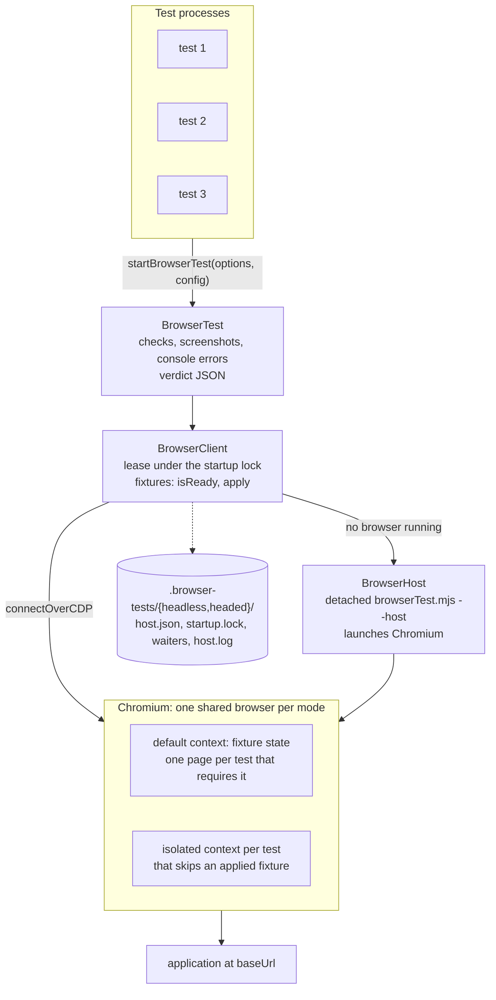

# @blockchainian/browser-test

A Playwright harness for browser tests that run as independent Node processes against one shared Chromium. Every test runs in its own Node process, and tests in each mode share one browser that the project's fixtures have prepared, for example by signing in. Independent processes, such as several agents each running a test command, connect to that browser over CDP, so they run in parallel without repeating setup or opening another window. The harness knows nothing about any project: a project describes its base URL, fixtures and Chromium flags in a config.

## Install

The package is consumed as a git dependency pinned to a commit, with Playwright as a peer dependency.

```sh
yarn add -D github:blockchainian/browser-test#<sha> playwright@1.64.1
```

Chromium comes from Playwright's own cache (`~/Library/Caches/ms-playwright`), so every project on the same Playwright version shares one browser install. Each project keeps its own profile.

## Architecture



All components live in `src/browserTest.mjs`.

Locks, waiters and leases belong to their recorded process IDs. A process is alive when `process.kill(pid, 0)` succeeds or returns `EPERM`; `ESRCH` makes its records stale. Clients reclaim stale startup locks while waiting, remove dead leases when reading host state, and remove dead waiters before checking whether the browser is idle. Live records remain in place.

The startup lock is published by atomically renaming a directory containing a PID-named owner file to `.browser-tests/<mode>/startup.lock/`. Reclamation removes only dead owners' files and then the empty directory, so competing clients cannot remove a replacement lock. Waiter files are published atomically so readers always see a complete PID.

| Component       | Responsibility                                                                                                                                                                                                                                                                                                                         |
| --------------- | -------------------------------------------------------------------------------------------------------------------------------------------------------------------------------------------------------------------------------------------------------------------------------------------------------------------------------------- |
| `BrowserTest`   | Owns the test's page. It records checks, screenshots and console errors, and on `finish()` prints one verdict JSON line.                                                                                                                                                                                                               |
| `BrowserClient` | Takes a lease on the shared browser under the startup lock and starts the host when no browser is running. It applies the fixtures the test requires, chooses the shared or an isolated context and opens the test's page. On release it closes the page and drops the lease, and it closes Chromium once no leases or waiters remain. |
| `BrowserHost`   | Runs as a detached `browserTest.mjs --host` process, so the browser outlives the test that started it. It launches Chromium with a persistent profile, a loopback CDP port per mode and the config's `launchArgs`. Headed mode uses `BROWSER_DISPLAY` in `.browser-tests/.env`; headless mode does not read it.                        |

## Config and fixtures

A project describes itself with a `BrowserTestConfig`.

```ts
interface BrowserTestConfig {
  baseUrl: string
  fixtures?: Fixture[]
  launchArgs?: string[]
}

interface Fixture {
  name: string
  isReady(context: BrowserContext): Promise<boolean>
  apply(context: BrowserContext): Promise<void>
}
```

`baseUrl` is exposed to tests as `test.baseUrl`. `launchArgs` are appended to the arguments the host passes to Chromium; the host receives them in the `BROWSER_TEST_LAUNCH_ARGS` environment variable, which keeps it detached from the test that started it. A fixture prepares the shared browser: `isReady` inspects the shared default `BrowserContext` and `apply` brings it to the ready state. Both receive that context and open and close their own pages.

## Scheduling

The first test to find no running browser starts the host. When the host is launched, `isReady` runs for every configured fixture and the ones already ready are recorded as applied, because fixture state kept in the persistent profile survives the host.

Under the startup lock, a test takes its lease and then looks up each fixture named in `requires`. It calls `isReady` on the shared default context and applies the fixture with `apply` when it is not ready. Every fixture applied on the shared browser is recorded in `host.json`, so each is applied once per browser. A test whose `requires` covers all recorded fixtures opens its page in the shared default context, shares its cookies and localStorage, and sees the effects of the fixtures. Console messages, network traffic and waits stay separate for each page. A test that does not require a recorded fixture opens its page in a new isolated context with no fixture state; closing that context leaves the shared state untouched. A name in `requires` that the config does not define is an error.

## Key interfaces

Tests import only `startBrowserTest()`. A project wraps it once so that tests do not repeat the config.

```js
// e2e/browserTest.mjs
import { startBrowserTest as start } from '@blockchainian/browser-test'

const config = {
  baseUrl: 'http://localhost:3000',
  fixtures: [signedInFixture],
  launchArgs: [],
}

export const startBrowserTest = (options) => start(options, config)
```

| Interface                                            | What it does                                                                                                                                                                          |
| ---------------------------------------------------- | ------------------------------------------------------------------------------------------------------------------------------------------------------------------------------------- |
| `startBrowserTest({ test, requires = [] }, config)`  | Receives the behavior text before leasing the browser, so startup failures retain it. Resolves with a `BrowserTest` that owns a new page, shared or isolated according to `requires`. |
| `test.page`                                          | The test's own Playwright `Page`. Use it directly for navigation, locators and waits.                                                                                                 |
| `test.baseUrl`                                       | The config's `baseUrl`.                                                                                                                                                               |
| `test.check(assertion, result, evidence, { fatal })` | Records one check. `result` is `'pass'`, `'fail'` or `'skip'`. A failed check with `fatal: true` fails the verdict even when `finish()` passes another verdict.                       |
| `test.screenshot(name)`                              | Saves a PNG under `.browser-tests/<mode>/output/`, records it in the verdict and resolves with its path.                                                                              |
| `test.finish(test, { timing, verdict, errors })`     | Receives the exact behavior text, releases the page, prints the verdict and exits. Optional `errors` records test errors.                                                             |

The verdict is one JSON line on stdout. `checks` contains only the test's own assertions; its `verdict` field is `pass` when no check failed, and `fail` otherwise. Console errors do not affect the verdict. `errors.console` contains every recorded error line without truncation, or an empty array when there are none. `test` contains only the exact behavior text passed to `startBrowserTest` and `finish()`. `errors.test` contains one entry per startup, uncaught exception, interrupt, missing `finish()`, page-close or lease-release error, or an empty array. These errors mark the verdict `inconclusive`; fatal failed checks still force `fail`. Startup errors include lease acquisition and fixture failures and execution inside the sandbox.

```json
{
  "verdict": "pass",
  "test": "Open the page to see its heading.",
  "checks": [
    {
      "assertion": "heading visible",
      "result": "pass",
      "evidence": "Welcome"
    }
  ],
  "errors": { "console": [], "test": [] },
  "screenshots": ["…/home-….png"],
  "timing": { "total_s": 2.29 }
}
```

## Running

Run a test with `node <test file>` from the project's repository and read the last stdout line. The application at `baseUrl` must already be running. Chromium cannot start inside the Codex sandbox, so tests run outside it.

Tests default to `--headless=yes`. Pass `--headless=no` to show the browser, for example `node e2e/home.mjs --headless=no`. Only `yes` and `no` are accepted. The harness reads this argument; test files need no changes. In headed mode the window can be placed on a named macOS display by setting `BROWSER_DISPLAY=<display name>` in `.browser-tests/.env`.

Headless and headed tests can run at the same time. Each mode has its own background browser and persistent profile under `.browser-tests/headless/` or `.browser-tests/headed/` at the root of the git repository the test runs in. Add `.browser-tests/` to the project's `.gitignore`.

| Path            | Contents                                                                               |
| --------------- | -------------------------------------------------------------------------------------- |
| `host.json`     | Debugging endpoint, host process ID, active leases and applied fixture names.          |
| `startup.lock/` | Directory holding a file named after the owning process ID while leasing or releasing. |
| `waiters/`      | One file per test waiting for the lock, so the browser stays up while tests queue.     |
| `host.log`      | Host stdout and stderr plus lease and close events.                                    |
| `profile/`      | The persistent Chromium profile.                                                       |
| `output/`       | Screenshots, one directory per test run.                                               |

## Writing a test

```js
#!/usr/bin/env node
import { startBrowserTest } from './browserTest.mjs'

const BEHAVIOR = 'Open the page to see its heading.'

// Start the test with the fixtures it needs
const test = await startBrowserTest({ test: BEHAVIOR, requires: ['signed-in'] })
const { page } = test

// Open the page
await page.goto(test.baseUrl)

try {
  // Check that the heading is visible
  const heading = page.getByRole('heading').first()
  await heading.waitFor({ timeout: 1_000 })
  test.check('heading visible', 'pass', await heading.textContent())
} catch (error) {
  test.check('heading visible', 'fail', error.message)
}

await test.screenshot('home')

await test.finish(BEHAVIOR)
```

Add a comment for each step and separate steps with blank lines. Do not add wait times to make a test pass: long waits mask errors in the application and its backend. Do not enforce timeouts in the test itself; leave them to the runner outside the test.

## Tests

`yarn test` runs a smoke test that serves a local page and applies a fixture that sets a localStorage key. It checks that a test requiring the fixture sees the key, that a test requiring nothing gets an isolated context without it, and that the same holds on a new host whose profile still holds the key.
